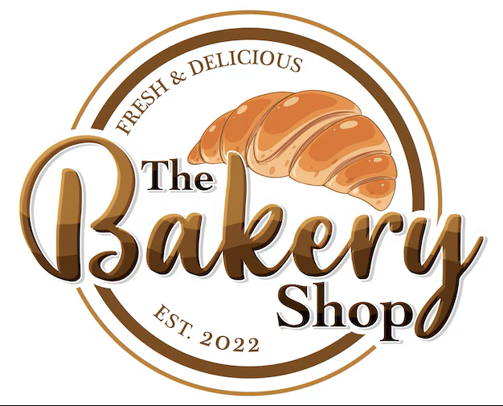

# The Bakery Shop: Dashboards



Two mobile-first dashboards for The Bakery Shop, each a single static page hosted on GitHub Pages. Both share the logo, colors and large 56 px buttons.

| Dashboard | File | Live page |
|---|---|---|
| Sales | `index.html` | https://sagi1237.github.io/claude-code-dashboard/ |
| HR Onboarding | `hr.html` | https://sagi1237.github.io/claude-code-dashboard/hr.html |

The HR dashboard is described in [spec.md](spec.md). Working rules for this repo are in [practice.md](practice.md).

## HR Onboarding dashboard

Tracks every new hire from signed offer to first month.

- **Team filter:** All, Kitchen, Counter, Delivery, Admin.
- **KPI cards:** new hires this month, in progress, overdue tasks, average days to complete.
- **Onboarding pipeline:** a card per hire with progress bar, status (On track, Needs attention, Starting soon), Open Checklist and Send Reminder buttons.
- **Next tasks:** tap a task to mark it done; progress and counts update at once.
- **Starting soon:** hires starting in the next 14 days.
- **Onboarding by stage:** how many hires are in each stage.

All figures are mock data. Send Reminder and Add New Hire only show a message in this prototype.

## Sales dashboard

A sales dashboard for the shop's owner and counter staff.

### Features

- **Date range buttons:** Today, 7 Days, 30 Days, 90 Days.
- **KPI cards:** total sales, orders, average order and items sold, each with a % change vs the previous period.
- **Sales over time:** touch or hover the chart to see the value at any point.
- **Top sellers:** ranked top 5 products by units sold.
- **Sales by category:** donut chart with a large legend (Breads, Pastries, Cakes, Drinks).
- **Busiest hours:** bar chart with the peak hour highlighted.
- **Low stock alert:** items about to sell out today.
- **Recent sales:** the latest orders.
- **Add Sale:** large floating button that opens a sheet to record a sale (kept in memory, so it resets on reload).
- **Mobile friendly:** single column on phones, bottom tab bar, every button at least 56 px.
- **Branding:** the bakery logo and a palette taken from it, with teal as the complementary color.

All figures come from generated sample data, not a real sales system.

## Run locally

Open `index.html` (sales) or `hr.html` (HR) in a browser, or serve the folder:

```bash
npx http-server -p 8080 .
```

## Host on GitHub Pages

Push the repository, then in **Settings → Pages** choose the `main` branch and the `/ (root)` folder.
