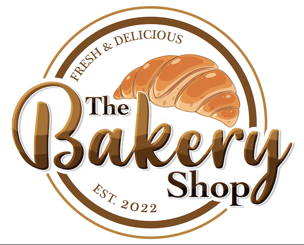

# The Bakery Shop: HR Dashboard (Employee Onboarding) Spec

A mobile-first dashboard that lets the bakery's owner and shift managers track every new hire from signed offer to a confident first month.
Managers mostly use it on a phone, between the oven and the counter, so everything is sized for thumbs.

Prototype with mock data: `hr.html` (open it in a browser). The earlier sales dashboard (`index.html`) keeps its own design and is unchanged.

## 1. Goals

- See who is starting, who is stuck and what is overdue in under 3 seconds.
- Complete the most common action (mark a task done, nudge a new hire) with one tap.
- Be fully usable one-handed on a 360 px wide phone.
- Look unmistakably like The Bakery Shop: same logo, colors and rounded, warm style as the sales dashboard.

## 2. Branding (same design line as the logo)

### 2.1 Logo

- Use `logo.png` (the croissant roundel) exactly as supplied. Do not recolor, stretch or crop.
- Header: 56 px high, left, on Cream. Empty states: centered at 160 px. Favicon and home-screen icon: the logo.
- Alt text: "The Bakery Shop".

### 2.2 Colors (sampled from the logo)

| Role | Name | Hex | Used for |
|---|---|---|---|
| Brand primary | Crust Brown | `#7A4A1E` | Headings, primary buttons, key figures |
| Brand dark | Espresso | `#3E2410` | Body text |
| Brand accent | Golden Crust | `#C98A2B` | Borders, active chip, progress bars |
| Brand warm | Croissant Orange | `#E08A3C` | Floating action button, highlights |
| Background | Cream | `#FFF6E5` | Page |
| Surface | Flour White | `#FFFFFF` | Cards |
| Complementary | Deep Teal | `#1F6F78` | Secondary buttons, "done / on track" |
| Complementary | Mint Tint | `#D8EEF0` | Secondary button fill |
| Alert | Berry Red | `#B3412F` | Overdue, blocked |

Rules: AA contrast (4.5:1) for text; never color alone (status always has an icon and a word, such as "✔ Done", "⚠ Overdue").

### 2.3 Typography

Nunito everywhere, base 16 px, key figures 30 to 40 px bold, tabular figures for numbers.

## 3. Mobile responsive

- Design at 360 × 800 first. Breakpoints: 600 px (2 columns) and 1024 px (3 to 4 columns).
- Single column on phones, no horizontal scrolling at any width, charts and bars resize to the container.
- Bottom tab bar (64 px): Overview · New Hires · Tasks · Team.
- Safe-area insets respected; works in portrait and landscape.

## 4. Large buttons

- Minimum tap target 56 × 56 px; primary actions 64 px tall and full width on phones.
- 12 px minimum gap between buttons, 18 px bold labels, 24 px icons, 16 px corner radius.
- Visible pressed state and a 3 px Deep Teal focus ring.
- Types: **Primary** (Crust Brown, e.g. "Add New Hire"), **Secondary** (Mint with teal text, e.g. "Send Reminder", "Mark Done"), **Filter chips** (56 px pills, active = Golden Crust).
- A 72 px floating **+** button (Croissant Orange) opens "Add New Hire".

## 5. Screens and layout

1. **Header:** logo, "HR Onboarding", today's date.
2. **Filter chips:** `All` · `Kitchen` · `Counter` · `Delivery` · `Admin`.
3. **KPI cards (2 × 2):** New Hires This Month · Onboarding In Progress · Overdue Tasks · Avg Days to Complete.
4. **Onboarding pipeline:** one card per new hire: avatar initials, name, role, start date, progress bar (% of tasks done), status badge (On track / Needs attention / Starting soon), and two large buttons: **Open Checklist** and **Send Reminder**.
5. **Today's checklist:** the next tasks due, each a 56 px tappable row with a checkbox (tap to mark done).
6. **Starting soon:** hires starting within 14 days.
7. **Onboarding by stage:** horizontal bars, count of hires per stage (Offer Signed, Paperwork, Training, First Shifts, Complete).
8. **Bottom tab bar** and the floating "+" button.

## 6. Onboarding checklist (standard template)

| # | Task | Owner | Due (relative to start) |
|---|---|---|---|
| 1 | Sign contract and tax forms | HR | −3 days |
| 2 | Food hygiene certificate uploaded | New hire | −1 day |
| 3 | Uniform and apron issued | Manager | Day 1 |
| 4 | Kitchen and allergen safety walkthrough | Head baker | Day 1 |
| 5 | Shadow a shift with a buddy | Buddy | Day 2 to 3 |
| 6 | Learn the till and card reader (counter roles) | Manager | Day 3 |
| 7 | First solo shift | Manager | Day 7 |
| 8 | 30-day check-in | HR | Day 30 |

## 7. Data (mock)

Employee record:

| Field | Type | Example |
|---|---|---|
| `id` | string | `E-201` |
| `name` | string | `Maya Cohen` |
| `role` | string | `Baker's Assistant` |
| `team` | enum | `Kitchen` / `Counter` / `Delivery` / `Admin` |
| `startDate` | date | `2026-11-24` |
| `buddy` | string | `Dan Levi` |
| `tasks` | array of `{id, done, due}` | see section 6 |

Sample hires in the prototype: Maya Cohen (Baker's Assistant), Noam Katz (Barista), Lior Ben-David (Pastry Chef), Tamar Shalev (Cashier), Yossi Peretz (Delivery Driver), Rina Alon (Shift Manager), Omer Dahan (Dishwasher), Shira Golan (Barista).
Status is derived: overdue tasks → Needs attention; start date in the future → Starting soon; otherwise On track.

## 8. Behavior

- Tapping a checkbox updates the progress bar, KPIs and status immediately.
- "Send Reminder" shows a confirmation toast (no real message is sent in the prototype).
- Filter chips update all cards together.
- Empty state: logo plus "No new hires in this team yet."

## 9. Accessibility

Text status next to every color, labels on icon buttons, focus order follows visual order, keyboard operable, `prefers-reduced-motion` respected.

## 10. Out of scope (v1)

Real authentication and roles, payroll, document upload, real email/SMS sending, recruiting pipeline.

## 11. Acceptance criteria

- [ ] Logo in the header and empty state, unmodified.
- [ ] Only the palette in 2.2 is used.
- [ ] Every button, chip, checkbox row and tab is at least 56 px tall.
- [ ] No horizontal scroll at 360 px.
- [ ] KPI cards are visible without scrolling on a 360 × 800 screen.
